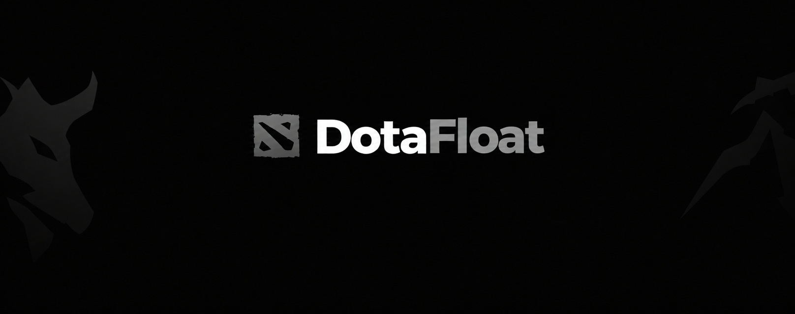

<p align="center">
  
</p>

<p align="center">
  <b>A handy all-in-one toolkit for Dota 2.</b><br/>
</p>

<p align="center">
  
  
  
</p>

---

DotaFloat is a lightweight toolkit built around one simple idea: all the small things you'd normally do by hand happen quietly in the background, so you can keep your head in the match where it belongs.

Everything is written in modern C++ and kept intentionally simple — no bloated menus, no endless settings. Just the tools you actually use, always one keystroke away.

##  Features

- **Auto Accept** — accepts the match the second it pops, so you never miss a game.
- **Autobuy** — your items get bought on time, no fumbling around the shop.
- **Auto Hex** — the hex lands by itself, right when it matters.
- **Advanced Maphack** — always see what's going on around the map.
- **Zoom Out** — pull the camera back for a wider view of the fight.
- **Hero Combos** — ready-made combo scripts for Invoker, Shadow Fiend and Tinker.

## Requirements

To build DotaFloat from source, make sure you have:

- **Windows** 10 or newer (x64)
- **Visual Studio 2022** with the *Desktop development with C++* workload
- **CMake** 3.20 or newer
- **Git** (optional)

---
````
⚠️ DotaFloat is intended for educational purposes only. Use it at your own risk.
````

